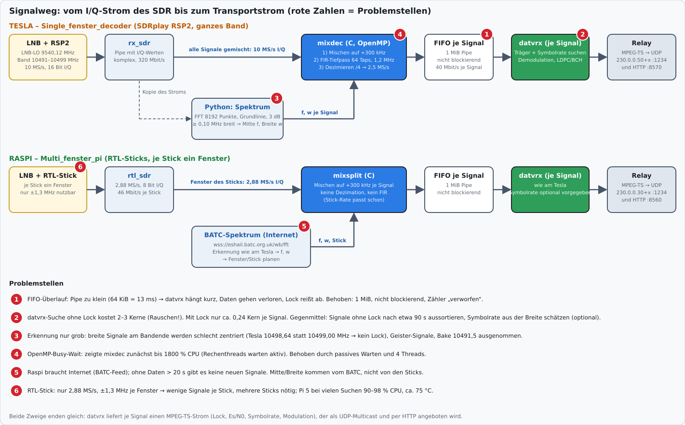
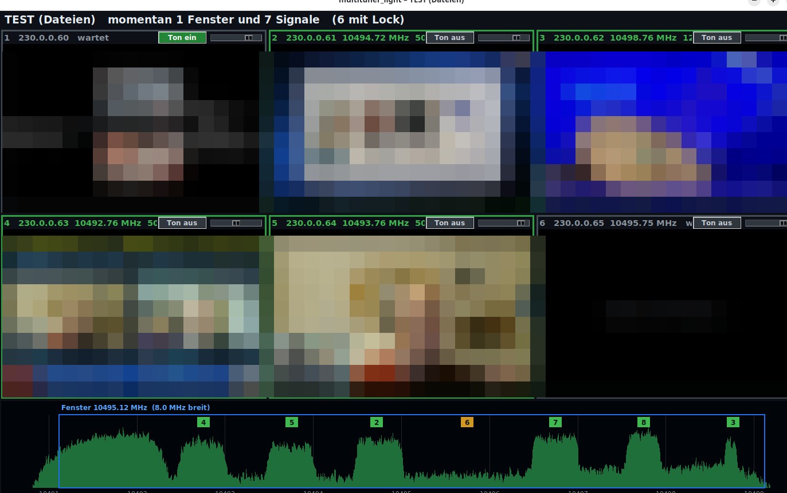
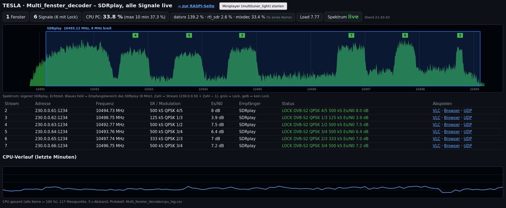
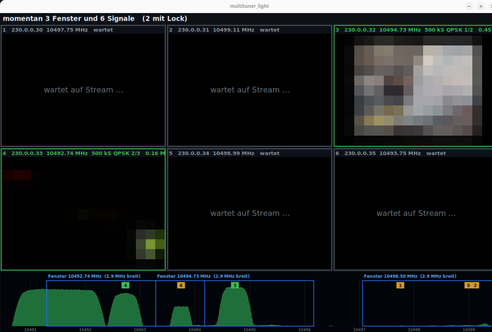
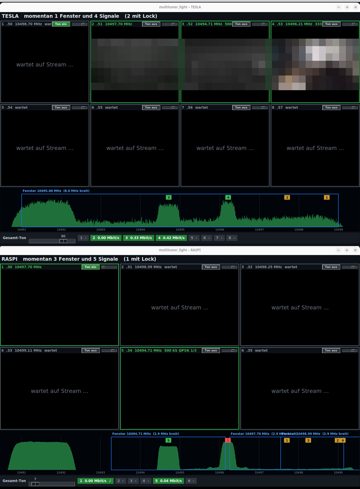

# QO-100 DATV: viele Signale gleichzeitig decodieren – Konzept

Konzeptbeschreibung (**ohne Code**) für den gleichzeitigen Empfang vieler DATV-Signale im QO-100-Schmalband (Downlink 10491,5 bis 10499,5 MHz):

* **Single_fenster** – ein SDRplay am PC, ein Fenster über das ganze Band, Signale werden im eigenen Spektrum gefunden.
* **Multi_fenster** – mehrere RTL-Sticks am Raspberry Pi, je Stick ein Fenster, Signale werden aus dem BATC-Spektrumfeed geplant.

Die **konventionelle Lösung** (je RTL-Stick ein Signal, bis zu 4 Sticks am Raspberry Pi 5) steht im Projekt [Raspi5-RTL-SDR-Multi-Receiver](https://github.com/dg7ndv/Raspi5-RTL-SDR-Multi-Receiver); dieses Konzept geht darüber hinaus und decodiert auch mehrere Signale je Empfänger.

Als Decoder dient `datvrx` (HB9IIU). Aus dem Breitband-I/Q-Strom wird für jedes Signal ein eigener, kleiner Strom erzeugt und je einem Decoder gegeben.

Die ausführliche Beschreibung mit Vergleich der Empfangskonzepte, Tücken und Messungen steht in **[konzept.html](konzept.html)** (eine einzelne Datei, Bilder sind eingebettet; zum Ansehen herunterladen und im Browser öffnen).

| Beispiel | |
|---|---|
|  |  |
|  |  |

Die Videoinhalte anderer Stationen in den Bildschirmfotos sind zu Mosaiken verpixelt.
Stand 22.11.2026, DG7NDV. Der Code ist (noch) nicht veröffentlicht. Alle Zahlen sind eigene Messungen.
